# Olist E-commerce SQL Analysis

SQL analysis of the [Olist Brazilian e-commerce dataset](https://www.kaggle.com/datasets/olistbr/brazilian-ecommerce) using MySQL. The project answers 13 business questions about revenue, customer behavior, delivery performance, reviews, and sellers, using joins, subqueries, CTEs, and window functions (`LAG`, `RANK`, `SUM() OVER`).

## Tools and Techniques

- MySQL
- Joins across 7 tables (`orders`, `order_items`, `order_payments`, `order_reviews`, `customers`, `products`, `product_category_name_translation`)
- CTEs and subqueries
- Window functions: `LAG()`, `RANK() OVER (PARTITION BY ...)`, running totals with `SUM() OVER (ORDER BY ...)`
- Pearson correlation computed manually, since MySQL has no native `CORR()`

## Repository Structure

```
├── olist_analysis.sql   # All queries, one section per question
├── images/              # Screenshots of each query result
└── README.md
```

## Data

The raw dataset is not included in this repository. Download it from [Kaggle](https://www.kaggle.com/datasets/olistbr/brazilian-ecommerce), load it into a MySQL schema named `olist`, and run `olist_analysis.sql`.

## Key Findings

- **Top categories:** `health_beauty` leads in revenue (about 1.26M), followed by `watches_gifts` and `bed_bath_table`. `bed_bath_table` has the highest sales volume (11,115 items).
- **Order value:** the overall average order value is 160.99. Paraíba (PB) has the highest AOV by state (264.08).
- **Customer retention:** 96.88% of customers bought only once. One-time customers account for 94.38% of revenue, while repeat customers spend more on average (262.02 vs. 138.65 per customer).
- **Delivery and satisfaction:** orders with a 1-star review took 21.3 days to arrive on average, versus 10.6 days for 5-star orders. The correlation between delivery time and review score is -0.24.
- **Late deliveries hurt:** late orders average a 2.57 review score, compared with 4.21 for on-time or early orders.
- **Payments:** credit card is the dominant method (73.92% of payments), followed by boleto (19.04%).
- **Growth:** revenue peaked in November 2017 (+52.06% vs. October), then fell 26.07% in December. Cumulative revenue passes the 50% mark in January 2018.
- **Geography:** São Paulo (SP) concentrates most orders (41,365) and has the fastest delivery (8.7 days), while remote states such as AP and RR average 28.2 days.

## Questions and Results

### Q1. Top 5 product categories by revenue and sales volume
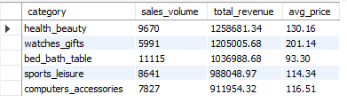

### Q2a. Overall average order value (AOV)
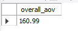

### Q2b. Top 5 states by AOV
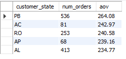

### Q2c. Average spend per order, by category
Note: an order can contain several categories, so this measures category-level spend, not full order value.

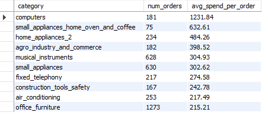

### Q3. Repeat purchases vs. one-time customers
`customer_id` is unique per order in this dataset, so customers are identified with `customer_unique_id`.

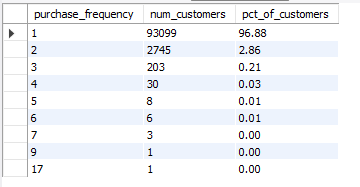

### Q4a. Delivery time vs. review score
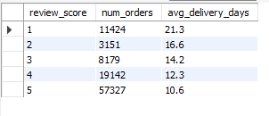

### Q4b. Pearson correlation (delivery time vs. review score)
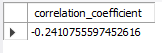

### Q5. Top sellers by revenue, with review scores
Reviews are given per order, not per seller, so in multi-seller orders the score is attributed to every seller involved.

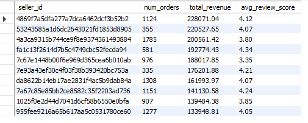

### Q6. Most used payment methods
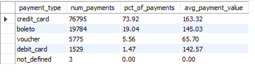

### Q7a. Impact of delivery delay on review scores
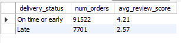

### Q7b. Categories with the lowest average review scores
Only categories with at least 30 reviews are included.

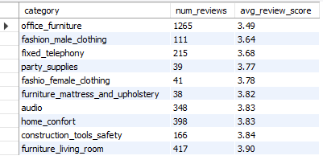

### Q7c. Price range vs. review scores
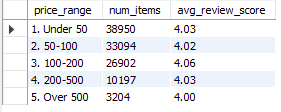

### Q8. Month-over-month revenue growth
Uses `LAG()`. Months with only 1-2 residual orders (2016-09, 2016-12, 2018-09) are excluded because they distort growth percentages.

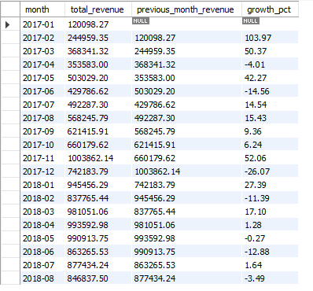

### Q9. Top 3 products by revenue within each category
Uses `RANK() OVER (PARTITION BY category ...)`.

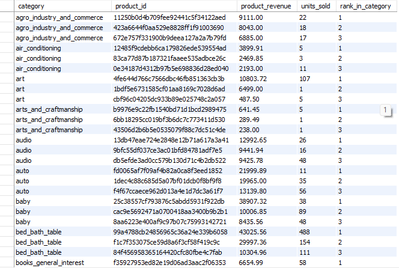

### Q10. Sales volume and delivery time by state
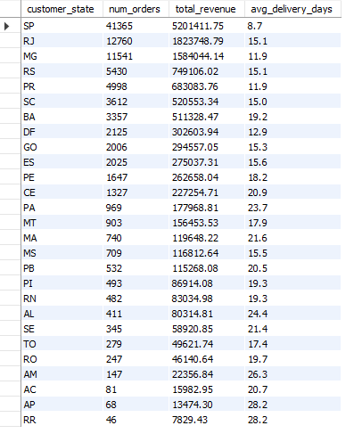

### Q11. Revenue share: repeat vs. one-time customers
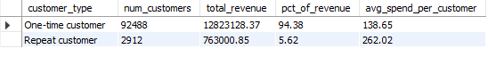

### Q12. Cumulative revenue and the 50% milestone
Uses a running total with `SUM() OVER (ORDER BY month)`.

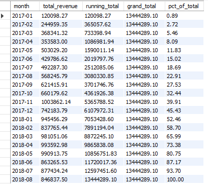

### Q13. Products priced above their category average
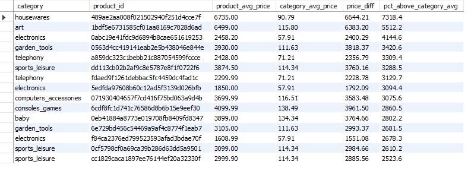
